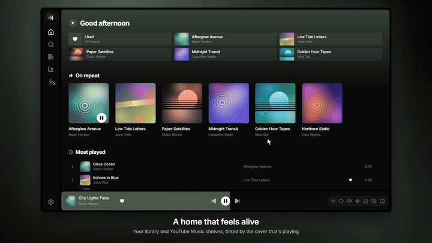
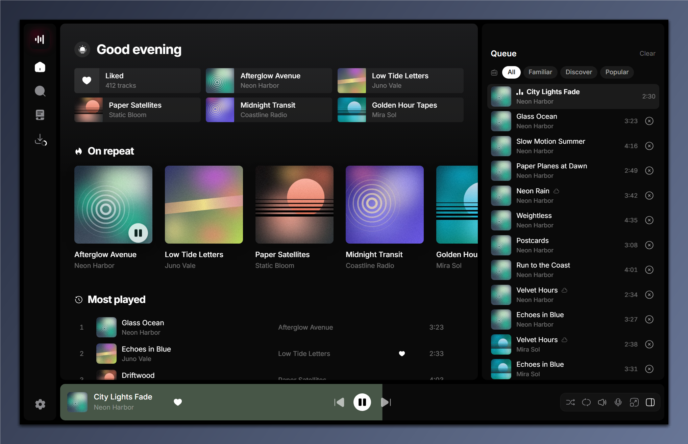
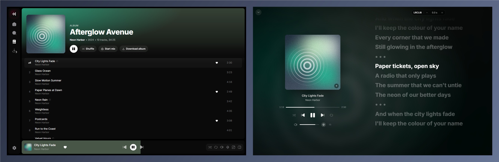
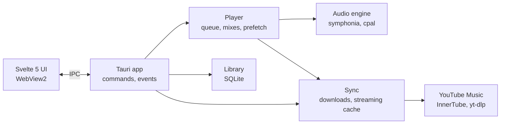

<div align="center">


# Mixtape

**A fast YouTube Music player for Windows, with your library on disk.**

Streams and downloads from your YouTube Music account, plays offline, and keeps mixes going like the web app does, in a light native window.

**English** · [Українська](README.uk.md) · [Русский](README.ru.md)


</div>

---

<p align="center">
  <a href="https://github.com/Reva1v/mixtape/releases/download/v0.1.0/mixtape-promo.mp4">
    
  </a>
  <br>
  <a href="https://github.com/Reva1v/mixtape/releases/download/v0.1.0/mixtape-promo.mp4"><b>▶ Watch the 70-second tour with sound</b></a>
  <br>
  <sub>Music in the video: “3am” by Tokyo Music Walker, CC BY 3.0.</sub>
</p>

<p align="center">
  
</p>

<p align="center">
  
</p>

<sub>Screenshots use the built-in demo data: invented artists and generated covers.</sub>

## Features

| | |
|---|---|
| 🎧 **Your YouTube Music** | Sign in with Google in an app window; likes, albums, artists and playlists come over to the library. |
| 📻 **Mixes** | «Start mix» on any track builds an endless radio with the same filter chips as YouTube Music (Familiar, Discover…). |
| ⚡ **Instant streaming** | Tracks play while they download and the next ones are prepared ahead, so skipping doesn't wait. |
| 💾 **Offline library** | Download a track, album, playlist or a whole discography; tracks you play often are kept automatically. |
| 🎤 **Synced lyrics** | Line-by-line lyrics from LRCLIB in the full-screen player, with an offset control. |
| 🔎 **Search** | Your library and the YouTube Music catalog in one place, with suggestions and recent searches. |
| ⌨️ **Keyboard and Windows** | Keyboard shortcuts, media keys, the Windows media overlay and taskbar buttons. |
| 🌐 **Three languages** | English, Ukrainian and Russian, switched in Settings without a restart. |

## Usage

1. Open **Settings → YouTube Music account → Connect** and sign in with Google.
2. Pick what to bring over: liked songs, albums, artists, playlists. Progress shows on the **Downloads** screen.
3. Play anything; right-click a track (or the player bar) for **Start mix**, **Play next**, **Download**, **Like**.
4. On an artist page, **Load all songs** reads the whole discography into the library without downloading it.

| Shortcut | Action |
|---|---|
| `Space` · `K` | Play / pause |
| `Ctrl + →` / `Ctrl + ←` | Next / previous track |
| `→` / `←` | Seek 5 seconds |
| `↑` / `↓` | Volume ±5% |
| `S` · `R` · `L` | Shuffle · repeat · like |
| `F` · `Q` · `T` | Full-screen player · queue · lyrics |
| `Ctrl + K` · `/` | Search |
| `Ctrl + L` | Add from link (a pasted YouTube link offers a download too) |
| `?` | All shortcuts |

## Installation

Download `Mixtape_<version>_x64-setup.exe` from **[Releases](https://github.com/Reva1v/mixtape/releases/latest)** and run it. It installs for the current user (no admin rights) and speaks English, Ukrainian or Russian, following Windows. The installer is unsigned, so Windows SmartScreen shows «Windows protected your PC»; choose **More info → Run anyway**.

## Privacy

Mixtape has no server of its own and no telemetry. Your data stays in `%LOCALAPPDATA%\Mixtape`: the SQLite database, downloaded tracks, the streaming cache (5 GB by default, adjustable in **Settings → Storage**) and covers. YouTube cookies from the sign-in are encrypted with Windows DPAPI (`account.bin`) and are sent only to YouTube.

The app talks to these services, and only for the feature named:

| Service | When | What is sent |
|---|---|---|
| YouTube Music (`music.youtube.com`, `googlevideo.com`, Google image hosts) | browsing, playback, downloads, likes | your YouTube cookies, what you open, search and play |
| Google sign-in (`accounts.google.com`) | **Connect** in Settings | your login, in a private window of the app |
| LRCLIB (`lrclib.net`) | opening lyrics | title, artist, album and duration of the track |
| Last.fm (`ws.audioscrobbler.com`) | only once you connect Last.fm | the tracks you play (scrobbles, «now playing») |
| Discord (local Rich Presence, no network from the app) | only with the Discord status turned on and Discord running | title, artist, cover link and time, to your Discord client |
| Spotify (`open.spotify.com` and its public web API) | importing a Spotify link | the playlist or album id; no account is used |
| SoundCloud, Bandcamp (through yt-dlp) | importing such a link | the link you pasted |
| GitHub (`github.com`) | the update check, once a day while it is on in Settings | a request for the latest release |

## Building from source

Requirements:

- Windows 10/11 with WebView2 (preinstalled on Windows 11);
- [Visual Studio Build Tools](https://visualstudio.microsoft.com/visual-cpp-build-tools/) with the **Desktop development with C++** workload (MSVC and the Windows SDK);
- [Rust](https://rustup.rs) 1.89+ (`x86_64-pc-windows-msvc`);
- [Node.js](https://nodejs.org) with [pnpm](https://pnpm.io);
- [CMake](https://cmake.org) for the bundled libopus: on `PATH`, or point the `CMAKE` environment variable at `cmake.exe` (Build Tools ship one under `Common7\IDE\CommonExtensions\Microsoft\CMake\CMake\bin`).

```powershell
git clone https://github.com/Reva1v/mixtape.git
cd mixtape
pnpm install                       # Tauri CLI and the interface (pnpm workspace)
./scripts/fetch-sidecars.ps1       # pinned yt-dlp and deno into src-tauri/binaries, checked by SHA-256
pnpm tauri dev                     # run in development
pnpm tauri build                   # installer in target/release/bundle/nsis
```

A plain `pnpm tauri build` needs no signing key: the installer just isn't signed for the in-app updater. Release builds are made with `scripts/release.ps1`, which signs the installer afterwards with the maintainer's key.

### Optional: Last.fm and Discord

Scrobbling and the Discord status need keys that are not in the repository; without them these features are hidden. They are read at compile time from environment variables or, when those are unset, from the gitignored `.secrets` folder:

| Feature | Environment variables | Or file |
|---|---|---|
| Last.fm | `MIXTAPE_LASTFM_KEY`, `MIXTAPE_LASTFM_SECRET` ([create an API account](https://www.last.fm/api/account/create)) | `.secrets/lastfm.json`: `{"key": "…", "secret": "…"}` |
| Discord | `MIXTAPE_DISCORD_APP_ID` | `.secrets/discord.json`: `{"appId": "…"}` |

Setting up the Discord application: [`docs/discord-app.md`](docs/discord-app.md).

## Architecture

The Rust core owns everything (library, player, network); the Svelte interface only draws it and talks to the core over Tauri IPC, with typed bindings generated from the Rust types.



| Layer | Technologies |
|---|---|
| Interface | Svelte 5, TypeScript, Tailwind CSS 4, Vite, motion, virtua |
| Shell | Tauri 2, WebView2 |
| Audio | symphonia + libopus, cpal (WASAPI), rubato |
| Data | SQLite (rusqlite), ts-rs bindings |
| Network | reqwest, YouTube Music InnerTube API, yt-dlp + deno sidecars, LRCLIB |
| Windows | `windows` crate: SMTC, taskbar buttons, DPAPI |

## Project layout

```
crates/core/       domain types shared by all crates and exported to TypeScript
crates/library/    SQLite library, search, library views, cache bookkeeping
crates/player/     queue, mixes, prefetching on top of the audio engine
crates/audio/      decoding, resampling, gapless and crossfaded output
crates/sync/       downloads, streaming into a sparse cache file, likes, lyrics
crates/yt/         everything that talks to YouTube Music
crates/artwork/    cover thumbnails and colour palettes
crates/win/        media overlay, taskbar buttons, DPAPI
src-tauri/         the app: commands, events, windows
ui/                the Svelte interface (ui/src/lib/i18n holds the translations)
specs/             feature specs, plan and status (Spec Kit)
scripts/           helper scripts (sidecar download)
```

## Development

```powershell
cargo test --workspace                       # Rust tests
cargo clippy --workspace --all-targets       # lints
pnpm -C ui check                             # svelte-check
pnpm -C ui dev                               # interface alone, open http://localhost:5173/?mock
```

`?mock` runs the interface in a browser on demo data; add `&lang=uk` and `&scene=album|library|fullscreen|queue` to open a given screen (this is how the screenshots are made). `MIXTAPE_DATA_DIR` points the app at another data folder.

## Documentation

- [`specs/001-mixtape-mvp/`](specs/001-mixtape-mvp) — specification, plan, tasks and [`STATUS.md`](specs/001-mixtape-mvp/STATUS.md) (in Russian).
- [`CONTRIBUTING.md`](CONTRIBUTING.md) — how to send changes; [`SECURITY.md`](SECURITY.md) — how to report a vulnerability.

## Disclaimer

Mixtape is an independent project. It is not affiliated with, endorsed or sponsored by Google, YouTube, Spotify, SoundCloud or Bandcamp; their names are used only to say what the app works with. It is meant for personal use with your own account. You are responsible for following the terms of service of these services and the copyright laws of your country, including for anything you download.

## License

Mixtape is free software under the [GNU General Public License v3.0 or later](LICENSE). Bundled and used third-party components and their licenses are listed in [`THIRD-PARTY-NOTICES.md`](THIRD-PARTY-NOTICES.md).
