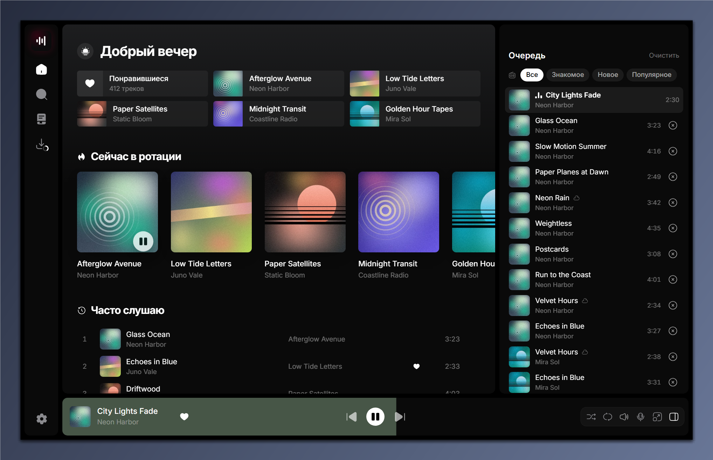
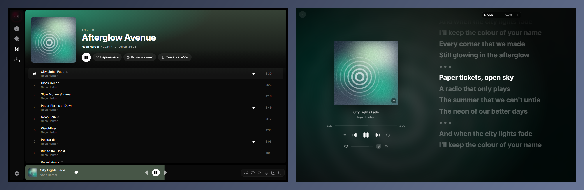
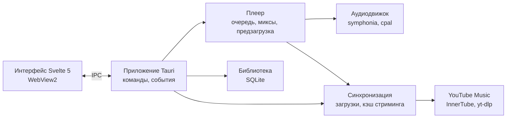

<div align="center">


# Mixtape

**Быстрый плеер YouTube Music для Windows с библиотекой на диске.**

Стримит и скачивает музыку из вашего аккаунта YouTube Music, играет офлайн и продолжает миксы так же, как веб-версия, — в лёгком нативном окне.

[English](README.md) · [Українська](README.uk.md) · **Русский**


</div>

---

<p align="center">
  <a href="https://github.com/Reva1v/mixtape/releases/download/v0.1.0/mixtape-promo.mp4">
    
  </a>
  <br>
  <a href="https://github.com/Reva1v/mixtape/releases/download/v0.1.0/mixtape-promo.mp4"><b>▶ Смотреть 70-секундный обзор со звуком</b></a>
  <br>
  <sub>Музыка в видео: «3am» — Tokyo Music Walker, CC BY 3.0.</sub>
</p>

<p align="center">
  
</p>

<p align="center">
  
</p>

<sub>На скриншотах — встроенные демоданные: выдуманные исполнители и сгенерированные обложки.</sub>

## Возможности

| | |
|---|---|
| 🎧 **Ваш YouTube Music** | Вход через Google в окне приложения; понравившиеся, альбомы, исполнители и плейлисты переносятся в библиотеку. |
| 📻 **Миксы** | «Включить микс» на любом треке запускает бесконечное радио с теми же фильтрами, что в YouTube Music (Знакомое, Популярное…). |
| ⚡ **Мгновенный стриминг** | Трек играет, пока скачивается, а следующие готовятся заранее, так что переключение не ждёт. |
| 💾 **Офлайн-библиотека** | Скачивайте трек, альбом, плейлист или всю дискографию; то, что вы часто слушаете, сохраняется автоматически. |
| 🎤 **Синхронный текст** | Текст песни построчно из LRCLIB в полноэкранном плеере, со сдвигом по времени. |
| 🔎 **Поиск** | Ваша библиотека и каталог YouTube Music в одном месте, с подсказками и недавними запросами. |
| ⌨️ **Клавиатура и Windows** | Горячие клавиши, медиаклавиши, медиапанель Windows и кнопки на панели задач. |
| 🌐 **Три языка** | Английский, украинский и русский, переключаются в настройках без перезапуска. |

## Как пользоваться

1. Откройте **Настройки → Аккаунт YouTube Music → Подключить** и войдите через Google.
2. Выберите, что перенести: понравившиеся песни, альбомы, исполнителей, плейлисты. Прогресс виден на экране **Загрузки**.
3. Включайте что угодно; правый клик по треку (или по панели плеера) — **Включить микс**, **Включить следующим**, **Скачать**, **Нравится**.
4. На странице исполнителя **Загрузить все песни** добавляет всю дискографию в библиотеку без скачивания.

| Клавиши | Действие |
|---|---|
| `Пробел` · `K` | Играть / пауза |
| `Ctrl + →` / `Ctrl + ←` | Следующий / предыдущий трек |
| `→` / `←` | Перемотка на 5 секунд |
| `↑` / `↓` | Громкость ±5% |
| `S` · `R` · `L` | Перемешать · повтор · нравится |
| `F` · `Q` · `T` | Полноэкранный плеер · очередь · текст |
| `Ctrl + K` · `/` | Поиск |
| `Ctrl + L` | Добавить по ссылке (вставленная ссылка YouTube тоже предложит скачать) |
| `?` | Все горячие клавиши |

## Установка

Скачайте `Mixtape_<version>_x64-setup.exe` из **[Releases](https://github.com/Reva1v/mixtape/releases/latest)** и запустите. Он ставит приложение для текущего пользователя (без прав администратора) и говорит на английском, украинском или русском — как Windows. Установщик не подписан, поэтому Windows SmartScreen покажет «Система Windows защитила ваш компьютер»; нажмите **Подробнее → Выполнить в любом случае**.

## Приватность

У Mixtape нет своего сервера и нет телеметрии. Ваши данные лежат в `%LOCALAPPDATA%\Mixtape`: база SQLite, скачанные треки, кэш стриминга (5 ГБ по умолчанию, меняется в **Настройки → Хранилище**) и обложки. Cookies YouTube после входа шифруются Windows DPAPI (`account.bin`) и отправляются только на YouTube.

Приложение обращается к этим сервисам, и только ради указанной функции:

| Сервис | Когда | Что отправляется |
|---|---|---|
| YouTube Music (`music.youtube.com`, `googlevideo.com`, серверы картинок Google) | просмотр, воспроизведение, загрузки, лайки | ваши cookies YouTube, что вы открываете, ищете и слушаете |
| Вход Google (`accounts.google.com`) | **Подключить** в настройках | ваш логин — в приватном окне приложения |
| LRCLIB (`lrclib.net`) | открытие текста песни | название, исполнитель, альбом и длительность трека |
| Last.fm (`ws.audioscrobbler.com`) | только после подключения Last.fm | что вы слушаете (скробблы, «сейчас играет») |
| Discord (локальный Rich Presence, без сети из приложения) | только с включённым статусом Discord и запущенным Discord | название, исполнитель, ссылка на обложку и время — вашему клиенту Discord |
| Spotify (`open.spotify.com` и его публичный веб-API) | импорт ссылки Spotify | id плейлиста или альбома; аккаунт не используется |
| SoundCloud, Bandcamp (через yt-dlp) | импорт такой ссылки | вставленная ссылка |
| GitHub (`github.com`) | проверка обновлений раз в день, пока она включена в настройках | запрос последнего релиза |

## Сборка из исходников

Нужно:

- Windows 10/11 с WebView2 (в Windows 11 уже есть);
- [Visual Studio Build Tools](https://visualstudio.microsoft.com/visual-cpp-build-tools/) с набором **Desktop development with C++** (MSVC и Windows SDK);
- [Rust](https://rustup.rs) 1.89+ (`x86_64-pc-windows-msvc`);
- [Node.js](https://nodejs.org) с [pnpm](https://pnpm.io);
- [CMake](https://cmake.org) для встроенного libopus: в `PATH` или через переменную окружения `CMAKE` с путём к `cmake.exe` (в Build Tools он лежит в `Common7\IDE\CommonExtensions\Microsoft\CMake\CMake\bin`).

```powershell
git clone https://github.com/Reva1v/mixtape.git
cd mixtape
pnpm install                       # Tauri CLI и интерфейс (pnpm workspace)
./scripts/fetch-sidecars.ps1       # yt-dlp и deno фиксированных версий в src-tauri/binaries, с проверкой SHA-256
pnpm tauri dev                     # запуск в режиме разработки
pnpm tauri build                   # установщик в target/release/bundle/nsis
```

Обычному `pnpm tauri build` ключ подписи не нужен: установщик просто не подписан для встроенного обновления. Релизы собирает `scripts/release.ps1`, который подписывает установщик ключом автора уже после сборки.

### Необязательно: Last.fm и Discord

Скробблингу и статусу в Discord нужны ключи, которых нет в репозитории; без них эти функции скрыты. Они берутся при сборке из переменных окружения, а если тех нет — из папки `.secrets` (она в .gitignore):

| Функция | Переменные окружения | Или файл |
|---|---|---|
| Last.fm | `MIXTAPE_LASTFM_KEY`, `MIXTAPE_LASTFM_SECRET` ([создать API-аккаунт](https://www.last.fm/api/account/create)) | `.secrets/lastfm.json`: `{"key": "…", "secret": "…"}` |
| Discord | `MIXTAPE_DISCORD_APP_ID` | `.secrets/discord.json`: `{"appId": "…"}` |

Настройка приложения Discord: [`docs/discord-app.md`](docs/discord-app.md) (на английском).

## Архитектура

Всем владеет ядро на Rust (библиотека, плеер, сеть); интерфейс на Svelte только рисует состояние и общается с ядром через Tauri IPC, а типы для него генерируются из типов Rust.



| Слой | Технологии |
|---|---|
| Интерфейс | Svelte 5, TypeScript, Tailwind CSS 4, Vite, motion, virtua |
| Оболочка | Tauri 2, WebView2 |
| Аудио | symphonia + libopus, cpal (WASAPI), rubato |
| Данные | SQLite (rusqlite), привязки ts-rs |
| Сеть | reqwest, YouTube Music InnerTube API, сайдкары yt-dlp + deno, LRCLIB |
| Windows | крейт `windows`: SMTC, кнопки панели задач, DPAPI |

## Структура проекта

```
crates/core/       доменные типы для всех крейтов, экспортируются в TypeScript
crates/library/    библиотека SQLite, поиск, списки библиотеки, учёт кэша
crates/player/     очередь, миксы, предзагрузка поверх аудиодвижка
crates/audio/      декодирование, ресемплинг, вывод без пауз и с кроссфейдом
crates/sync/       загрузки, стриминг в разреженный файл кэша, лайки, тексты
crates/yt/         всё, что общается с YouTube Music
crates/artwork/    миниатюры обложек и цветовые палитры
crates/win/        медиапанель, кнопки на панели задач, DPAPI
src-tauri/         приложение: команды, события, окна
ui/                интерфейс на Svelte (переводы — в ui/src/lib/i18n)
specs/             спецификации, план и статус (Spec Kit)
scripts/           вспомогательные скрипты (загрузка сайдкаров)
```

## Разработка

```powershell
cargo test --workspace                       # тесты Rust
cargo clippy --workspace --all-targets       # линтер
pnpm -C ui check                             # svelte-check
pnpm -C ui dev                               # только интерфейс: http://localhost:5173/?mock
```

`?mock` запускает интерфейс в браузере на демоданных; добавьте `&lang=ru` и `&scene=album|library|fullscreen|queue`, чтобы открыть нужный экран (так сделаны скриншоты). `MIXTAPE_DATA_DIR` указывает приложению другую папку с данными.

## Документация

- [`specs/001-mixtape-mvp/`](specs/001-mixtape-mvp) — спецификация, план, задачи и [`STATUS.md`](specs/001-mixtape-mvp/STATUS.md).
- [`CONTRIBUTING.md`](CONTRIBUTING.md) — как предложить изменения; [`SECURITY.md`](SECURITY.md) — как сообщить об уязвимости (оба на английском).

## Отказ от ответственности

Mixtape — независимый проект. Он не связан с Google, YouTube, Spotify, SoundCloud и Bandcamp, не одобрен и не спонсируется ими; их названия используются только чтобы сказать, с чем работает приложение. Оно предназначено для личного использования с вашим собственным аккаунтом. Соблюдение условий использования этих сервисов и авторского права вашей страны, в том числе для всего, что вы скачиваете, — ваша ответственность.

## Лицензия

Mixtape — свободное ПО под [GNU General Public License v3.0 или более поздней версии](LICENSE). Используемые и поставляемые сторонние компоненты и их лицензии перечислены в [`THIRD-PARTY-NOTICES.md`](THIRD-PARTY-NOTICES.md).
