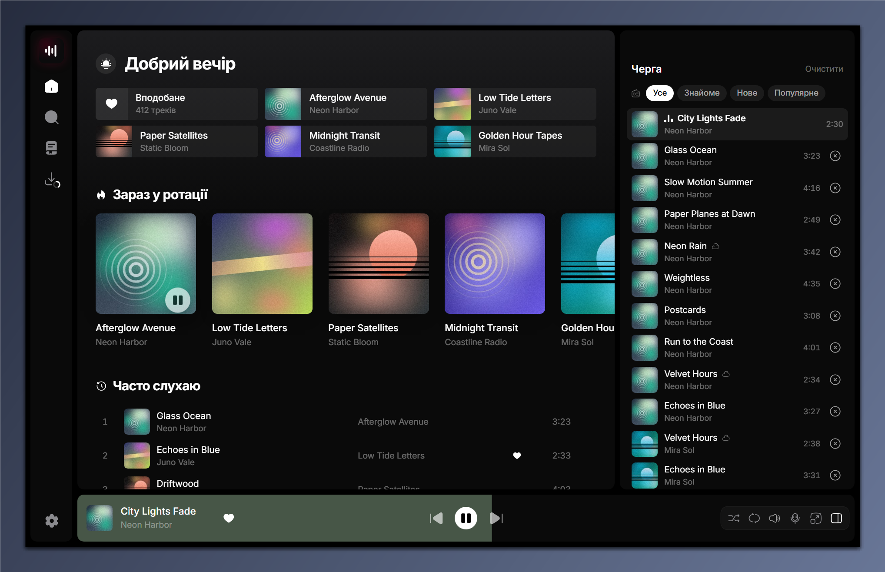
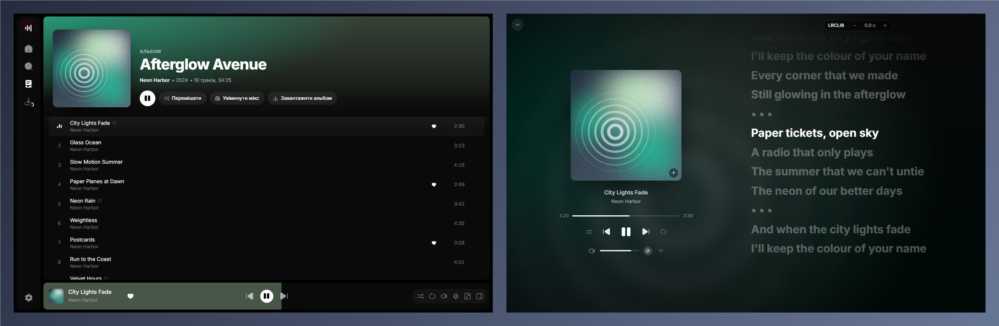
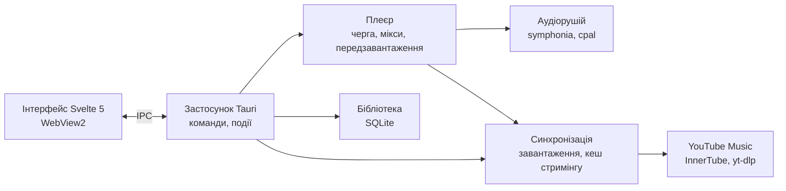

<div align="center">


# Mixtape

**Швидкий плеєр YouTube Music для Windows із бібліотекою на диску.**

Стрімить і завантажує музику з вашого акаунта YouTube Music, грає офлайн і продовжує мікси так само, як вебверсія, — у легкому нативному вікні.

[English](README.md) · **Українська** · [Русский](README.ru.md)


</div>

---

<p align="center">
  <a href="https://github.com/Reva1v/mixtape/releases/download/v0.1.0/mixtape-promo.mp4">
    
  </a>
  <br>
  <a href="https://github.com/Reva1v/mixtape/releases/download/v0.1.0/mixtape-promo.mp4"><b>▶ Дивитися 70-секундний огляд зі звуком</b></a>
  <br>
  <sub>Музика у відео: «3am» — Tokyo Music Walker, CC BY 3.0.</sub>
</p>

<p align="center">
  
</p>

<p align="center">
  
</p>

<sub>На скриншотах — вбудовані демодані: вигадані виконавці та згенеровані обкладинки.</sub>

## Можливості

| | |
|---|---|
| 🎧 **Ваш YouTube Music** | Вхід через Google у вікні застосунку; вподобане, альбоми, виконавці й плейлисти переносяться в бібліотеку. |
| 📻 **Мікси** | «Увімкнути мікс» на будь-якому треку запускає нескінченне радіо з тими самими фільтрами, що й у YouTube Music (Знайоме, Популярне…). |
| ⚡ **Миттєвий стримінг** | Трек грає, поки завантажується, а наступні готуються заздалегідь, тож перемикання не чекає. |
| 💾 **Офлайн-бібліотека** | Завантажуйте трек, альбом, плейлист або всю дискографію; те, що ви часто слухаєте, зберігається автоматично. |
| 🎤 **Синхронізований текст** | Текст пісні рядок за рядком із LRCLIB у повноекранному плеєрі, зі зсувом часу. |
| 🔎 **Пошук** | Ваша бібліотека й каталог YouTube Music в одному місці, з підказками та нещодавніми запитами. |
| ⌨️ **Клавіатура та Windows** | Гарячі клавіші, медіаклавіші, медіапанель Windows і кнопки на панелі завдань. |
| 🌐 **Три мови** | Англійська, українська й російська, перемикаються в налаштуваннях без перезапуску. |

## Як користуватися

1. Відкрийте **Налаштування → Акаунт YouTube Music → Підключити** й увійдіть через Google.
2. Оберіть, що перенести: вподобані пісні, альбоми, виконавців, плейлисти. Прогрес видно на екрані **Завантаження**.
3. Вмикайте будь-що; правий клік по треку (або по панелі плеєра) — **Увімкнути мікс**, **Увімкнути наступним**, **Завантажити**, **Подобається**.
4. На сторінці виконавця **Отримати всі пісні** додає всю дискографію в бібліотеку без завантаження.

| Клавіші | Дія |
|---|---|
| `Пробіл` · `K` | Грати / пауза |
| `Ctrl + →` / `Ctrl + ←` | Наступний / попередній трек |
| `→` / `←` | Перемотування на 5 секунд |
| `↑` / `↓` | Гучність ±5% |
| `S` · `R` · `L` | Перемішати · повтор · подобається |
| `F` · `Q` · `T` | Повноекранний плеєр · черга · текст |
| `Ctrl + K` · `/` | Пошук |
| `Ctrl + L` | Додати за посиланням (вставлене посилання YouTube теж запропонує завантаження) |
| `?` | Усі гарячі клавіші |

## Встановлення

Завантажте `Mixtape_0.1.0_x64-setup.exe` з **[Releases](https://github.com/Reva1v/mixtape/releases/latest)** і запустіть. Він встановлює застосунок для поточного користувача (без прав адміністратора) і говорить англійською, українською або російською — як Windows. Інсталятор не підписаний, тому Windows SmartScreen покаже «Windows захистила ваш ПК»; натисніть **Докладніше → Усе одно запустити**.

## Приватність

У Mixtape немає власного сервера й немає телеметрії. Ваші дані лежать у `%LOCALAPPDATA%\Mixtape`: база SQLite, завантажені треки, кеш стримінгу (5 ГБ за замовчуванням, змінюється в **Налаштування → Сховище**) і обкладинки. Cookies YouTube після входу шифруються Windows DPAPI (`account.bin`) і надсилаються лише на YouTube.

Застосунок звертається до цих сервісів, і лише заради вказаної функції:

| Сервіс | Коли | Що надсилається |
|---|---|---|
| YouTube Music (`music.youtube.com`, `googlevideo.com`, сервери зображень Google) | перегляд, відтворення, завантаження, вподобання | ваші cookies YouTube, що ви відкриваєте, шукаєте й слухаєте |
| Вхід Google (`accounts.google.com`) | **Підключити** в налаштуваннях | ваш логін — у приватному вікні застосунку |
| LRCLIB (`lrclib.net`) | відкриття тексту пісні | назва, виконавець, альбом і тривалість треку |
| Last.fm (`ws.audioscrobbler.com`) | лише після підключення Last.fm | що ви слухаєте (скроблі, «зараз грає») |
| Discord (локальний Rich Presence, без мережі із застосунку) | лише з увімкненим статусом Discord і запущеним Discord | назва, виконавець, посилання на обкладинку й час — вашому клієнту Discord |
| Spotify (`open.spotify.com` і його публічний веб-API) | імпорт посилання Spotify | id плейлиста чи альбому; акаунт не використовується |
| SoundCloud, Bandcamp (через yt-dlp) | імпорт такого посилання | вставлене посилання |
| GitHub (`github.com`) | перевірка оновлень раз на день, поки вона ввімкнена в налаштуваннях | запит останнього релізу |

## Збирання з вихідного коду

Потрібно:

- Windows 10/11 з WebView2 (у Windows 11 уже є);
- [Visual Studio Build Tools](https://visualstudio.microsoft.com/visual-cpp-build-tools/) з набором **Desktop development with C++** (MSVC і Windows SDK);
- [Rust](https://rustup.rs) 1.89+ (`x86_64-pc-windows-msvc`);
- [Node.js](https://nodejs.org) з [pnpm](https://pnpm.io);
- [CMake](https://cmake.org) для вбудованого libopus: у `PATH` або через змінну середовища `CMAKE` зі шляхом до `cmake.exe` (у Build Tools він лежить у `Common7\IDE\CommonExtensions\Microsoft\CMake\CMake\bin`).

```powershell
git clone https://github.com/Reva1v/mixtape.git
cd mixtape
pnpm install                       # Tauri CLI та інтерфейс (pnpm workspace)
./scripts/fetch-sidecars.ps1       # yt-dlp і deno зафіксованих версій у src-tauri/binaries, з перевіркою SHA-256
pnpm tauri dev                     # запуск у режимі розробки
pnpm tauri build                   # інсталятор у target/release/bundle/nsis
```

Звичайному `pnpm tauri build` ключ підпису не потрібен: інсталятор просто не підписаний для вбудованого оновлення. Релізи збирає `scripts/release.ps1`, який підписує інсталятор ключем автора вже після збирання.

### Необов'язково: Last.fm і Discord

Скроблінгу та статусу в Discord потрібні ключі, яких немає в репозиторії; без них ці функції приховані. Вони беруться під час збирання зі змінних середовища, а якщо їх немає — з теки `.secrets` (вона в .gitignore):

| Функція | Змінні середовища | Або файл |
|---|---|---|
| Last.fm | `MIXTAPE_LASTFM_KEY`, `MIXTAPE_LASTFM_SECRET` ([створити API-акаунт](https://www.last.fm/api/account/create)) | `.secrets/lastfm.json`: `{"key": "…", "secret": "…"}` |
| Discord | `MIXTAPE_DISCORD_APP_ID` | `.secrets/discord.json`: `{"appId": "…"}` |

Налаштування застосунку Discord: [`docs/discord-app.md`](docs/discord-app.md) (англійською).

## Архітектура

Усім володіє ядро на Rust (бібліотека, плеєр, мережа); інтерфейс на Svelte лише малює стан і спілкується з ядром через Tauri IPC, а типи для нього генеруються з типів Rust.



| Шар | Технології |
|---|---|
| Інтерфейс | Svelte 5, TypeScript, Tailwind CSS 4, Vite, motion, virtua |
| Оболонка | Tauri 2, WebView2 |
| Аудіо | symphonia + libopus, cpal (WASAPI), rubato |
| Дані | SQLite (rusqlite), прив'язки ts-rs |
| Мережа | reqwest, YouTube Music InnerTube API, сайдкари yt-dlp + deno, LRCLIB |
| Windows | крейт `windows`: SMTC, кнопки панелі завдань, DPAPI |

## Структура проєкту

```
crates/core/       доменні типи для всіх крейтів, експортуються в TypeScript
crates/library/    бібліотека SQLite, пошук, списки бібліотеки, облік кешу
crates/player/     черга, мікси, передзавантаження поверх аудіорушія
crates/audio/      декодування, ресемплінг, вивід без пауз і з кросфейдом
crates/sync/       завантаження, стримінг у розріджений файл кешу, лайки, тексти
crates/yt/         усе, що працює з YouTube Music
crates/artwork/    мініатюри обкладинок і палітри кольорів
crates/win/        медіапанель, кнопки на панелі завдань, DPAPI
src-tauri/         застосунок: команди, події, вікна
ui/                інтерфейс на Svelte (переклади — в ui/src/lib/i18n)
specs/             специфікації, план і статус (Spec Kit)
scripts/           допоміжні скрипти (завантаження сайдкарів)
```

## Розробка

```powershell
cargo test --workspace                       # тести Rust
cargo clippy --workspace --all-targets       # лінтер
pnpm -C ui check                             # svelte-check
pnpm -C ui dev                               # лише інтерфейс: http://localhost:5173/?mock
```

`?mock` запускає інтерфейс у браузері на демоданих; додайте `&lang=uk` і `&scene=album|library|fullscreen|queue`, щоб відкрити потрібний екран (так зроблено скриншоти). `MIXTAPE_DATA_DIR` вказує застосунку іншу папку з даними.

## Документація

- [`specs/001-mixtape-mvp/`](specs/001-mixtape-mvp) — специфікація, план, завдання та [`STATUS.md`](specs/001-mixtape-mvp/STATUS.md) (російською).
- [`CONTRIBUTING.md`](CONTRIBUTING.md) — як запропонувати зміни; [`SECURITY.md`](SECURITY.md) — як повідомити про вразливість (обидва англійською).

## Відмова від відповідальності

Mixtape — незалежний проєкт. Він не пов'язаний з Google, YouTube, Spotify, SoundCloud і Bandcamp, не схвалений і не спонсорований ними; їхні назви вжито лише щоб сказати, з чим працює застосунок. Він призначений для особистого використання з вашим власним акаунтом. Дотримання умов використання цих сервісів і авторського права вашої країни, зокрема щодо всього, що ви завантажуєте, — ваша відповідальність.

## Ліцензія

Mixtape — вільне ПЗ під [GNU General Public License v3.0 або пізнішої версії](LICENSE). Використані й постачені сторонні компоненти та їхні ліцензії перелічено в [`THIRD-PARTY-NOTICES.md`](THIRD-PARTY-NOTICES.md).
