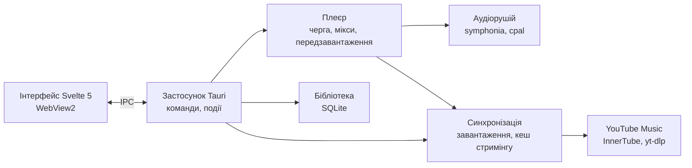

<div align="center">


# Mixtape

**Швидкий плеєр YouTube Music для Windows із бібліотекою на диску.**

Стрімить і завантажує музику з вашого акаунта YouTube Music, грає офлайн і продовжує мікси так само, як вебверсія, — у легкому нативному вікні.

[English](README.md) · **Українська** · [Русский](README.ru.md)


</div>

---

<p align="center">
  
</p>

<p align="center">
  
</p>

<sub>На скриншотах — вбудовані демодані: вигадані виконавці та згенеровані обкладинки.</sub>

## Можливості

| | |
|---|---|
| 🎧 **Ваш YouTube Music** | Вхід через Google у вікні застосунку; вподобане, альбоми, виконавці й плейлисти переносяться в бібліотеку. |
| 📻 **Мікси** | «Увімкнути мікс» на будь-якому треку запускає нескінченне радіо з тими самими фільтрами, що й у YouTube Music (Знайоме, Популярне…). |
| ⚡ **Миттєвий стримінг** | Трек грає, поки завантажується, а наступні готуються заздалегідь, тож перемикання не чекає. |
| 💾 **Офлайн-бібліотека** | Завантажуйте трек, альбом, плейлист або всю дискографію; те, що ви часто слухаєте, зберігається автоматично. |
| 🎤 **Синхронізований текст** | Текст пісні рядок за рядком із LRCLIB у повноекранному плеєрі, зі зсувом часу. |
| 🔎 **Пошук** | Ваша бібліотека й каталог YouTube Music в одному місці, з підказками та нещодавніми запитами. |
| ⌨️ **Клавіатура та Windows** | Гарячі клавіші, медіаклавіші, медіапанель Windows і кнопки на панелі завдань. |
| 🌐 **Три мови** | Англійська, українська й російська, перемикаються в налаштуваннях без перезапуску. |

## Як користуватися

1. Відкрийте **Налаштування → Акаунт YouTube Music → Підключити** й увійдіть через Google.
2. Оберіть, що перенести: вподобані пісні, альбоми, виконавців, плейлисти. Прогрес видно на екрані **Завантаження**.
3. Вмикайте будь-що; правий клік по треку (або по панелі плеєра) — **Увімкнути мікс**, **Увімкнути наступним**, **Завантажити**, **Подобається**.
4. На сторінці виконавця **Отримати всі пісні** додає всю дискографію в бібліотеку без завантаження.

| Клавіші | Дія |
|---|---|
| `Пробіл` · `K` | Грати / пауза |
| `Ctrl + →` / `Ctrl + ←` | Наступний / попередній трек |
| `→` / `←` | Перемотування на 5 секунд |
| `↑` / `↓` | Гучність ±5% |
| `S` · `R` · `L` | Перемішати · повтор · подобається |
| `F` · `Q` · `T` | Повноекранний плеєр · черга · текст |
| `Ctrl + K` · `/` | Пошук |
| `Ctrl + L` | Додати за посиланням (вставлене посилання YouTube теж запропонує завантаження) |
| `?` | Усі гарячі клавіші |

## Встановлення

Готових релізів поки немає: зберіть інсталятор із вихідного коду (нижче). Вийде `Mixtape_0.1.0_x64-setup.exe` — NSIS-інсталятор для поточного користувача англійською, українською або російською. Інсталятор не підписаний, тому Windows SmartScreen покаже «Windows захистила ваш ПК»; натисніть **Докладніше → Усе одно запустити**.

## Приватність

- Cookies YouTube після входу шифруються Windows DPAPI (`account.bin`) і надсилаються лише на YouTube.
- Усе інше лежить у `%LOCALAPPDATA%\Mixtape`: база SQLite, завантажені треки, кеш стримінгу (5 ГБ за замовчуванням, змінюється в **Налаштування → Сховище**) і обкладинки.
- Тексти пісень шукаються на LRCLIB за назвою, виконавцем, альбомом і тривалістю.

## Збирання з вихідного коду

Потрібно: Windows 10/11 із WebView2 (у Windows 11 уже є), [Rust](https://rustup.rs) 1.89+, [Node.js](https://nodejs.org) із [pnpm](https://pnpm.io).

```powershell
git clone https://github.com/Reva1v/mixtape.git
cd mixtape
pnpm install                       # Tauri CLI та інтерфейс (pnpm workspace)
./scripts/fetch-sidecars.ps1       # yt-dlp і deno в src-tauri/binaries
pnpm tauri dev                     # запуск у режимі розробки
pnpm tauri build                   # інсталятор у target/release/bundle/nsis
```

## Архітектура

Усім володіє ядро на Rust (бібліотека, плеєр, мережа); інтерфейс на Svelte лише малює стан і спілкується з ядром через Tauri IPC, а типи для нього генеруються з типів Rust.



| Шар | Технології |
|---|---|
| Інтерфейс | Svelte 5, TypeScript, Tailwind CSS 4, Vite, motion, virtua |
| Оболонка | Tauri 2, WebView2 |
| Аудіо | symphonia + libopus, cpal (WASAPI), rubato |
| Дані | SQLite (rusqlite), прив'язки ts-rs |
| Мережа | reqwest, YouTube Music InnerTube API, сайдкари yt-dlp + deno, LRCLIB |
| Windows | крейт `windows`: SMTC, кнопки панелі завдань, DPAPI |

## Структура проєкту

```
crates/core/       доменні типи для всіх крейтів, експортуються в TypeScript
crates/library/    бібліотека SQLite, пошук, списки бібліотеки, облік кешу
crates/player/     черга, мікси, передзавантаження поверх аудіорушія
crates/audio/      декодування, ресемплінг, вивід без пауз і з кросфейдом
crates/sync/       завантаження, стримінг у розріджений файл кешу, лайки, тексти
crates/yt/         усе, що працює з YouTube Music
crates/artwork/    мініатюри обкладинок і палітри кольорів
crates/win/        медіапанель, кнопки на панелі завдань, DPAPI
src-tauri/         застосунок: команди, події, вікна
ui/                інтерфейс на Svelte (переклади — в ui/src/lib/i18n)
specs/             специфікації, план і статус (Spec Kit)
scripts/           допоміжні скрипти (завантаження сайдкарів)
```

## Розробка

```powershell
cargo test --workspace                       # тести Rust
cargo clippy --workspace --all-targets       # лінтер
pnpm -C ui check                             # svelte-check
pnpm -C ui dev                               # лише інтерфейс: http://localhost:5173/?mock
```

`?mock` запускає інтерфейс у браузері на демоданих; додайте `&lang=uk` і `&scene=album|library|fullscreen|queue`, щоб відкрити потрібний екран (так зроблено скриншоти). `MIXTAPE_DATA_DIR` вказує застосунку іншу папку з даними.

## Документація

- [`specs/001-mixtape-mvp/`](specs/001-mixtape-mvp) — специфікація, план, завдання та [`STATUS.md`](specs/001-mixtape-mvp/STATUS.md) (російською).
